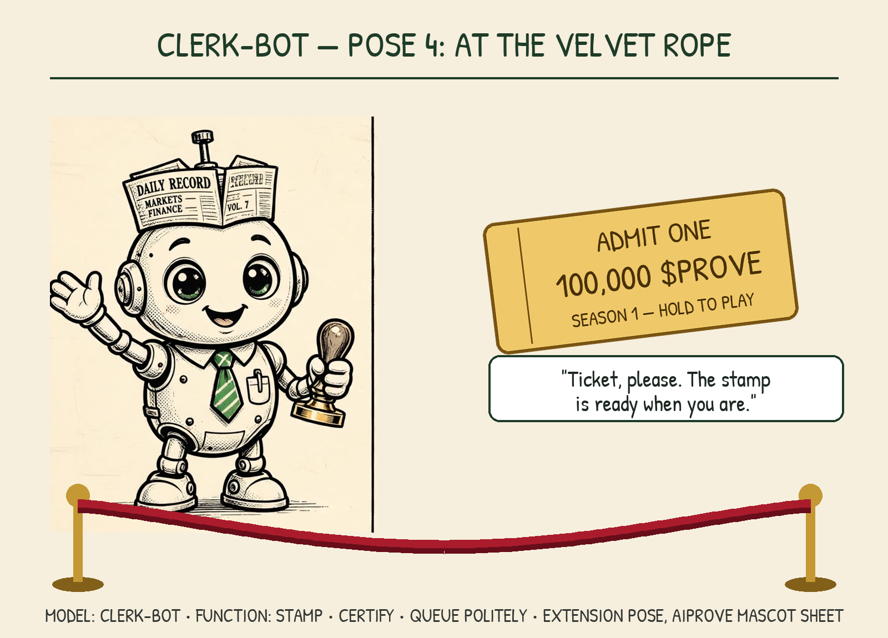

# Clerk-Bot — Pose 4: At the Velvet Rope (aiprove-mascot entry by noir)

Extension pose for the Clerk-Bot mascot sheet. The original Pose 1 Clerk-Bot
(waving, stamp in hand) composited with PIL onto a new sheet card
(`make_mascot3.py`), now working the Season 1 door: a golden
"ADMIT ONE — 100,000 $PROVE" ticket, a drawn velvet rope with gold
stanchions, and his professional position on the hold-to-play gate —
"Ticket, please. The stamp is ready when you are."

Function: stamp • certify • queue politely. Original composition, 2026-11-14.
